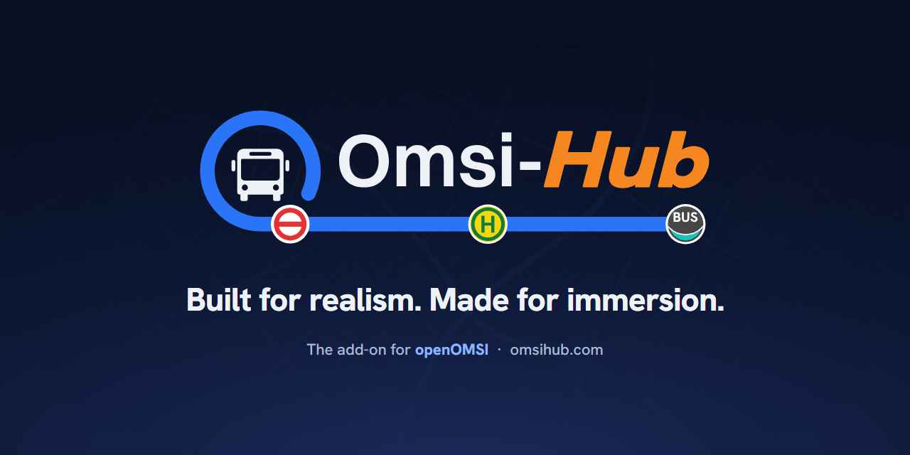

  

  <a href="https://omsihub.com"><b>Website</b></a> ·
  <a href="https://omsihub.com/download.html"><b>Download</b></a> ·
  <a href="https://omsihub.com/leaderboard.html">Leaderboard</a> ·
  <a href="https://omsihub.com/company.html">Bus company</a> ·
  <a href="https://omsihub.com/editors.html">Editors</a> ·
  <a href="https://omsihub.com/privacy.html">Privacy</a> ·
  <a href="https://ko-fi.com/omsihub">Ko-fi</a>

  
  
  
  

---

**Omsi-Hub** turns OMSI 2 into a working bus job: real duties from the timetable, your own transport
company, a career that counts, and friends on the same roads.

This repository is the home of the **Omsi-Hub add-on**: Omsi-Hub as its own app, with its own code.
It builds on the [openOMSI](https://github.com/openOMSI-org/openOMSI/releases) you already have and
talks to it through openOMSI's plugin API. It does not replace openOMSI, ships no game of its own and
contains no openOMSI code.

> [!NOTE]
> The add-on is being built here. Until its first release, the download on
> [omsihub.com](https://omsihub.com/download.html) is the current Omsi-Hub, which still comes with
> its own game.

## Requirements

| Needs | |
| --- | --- |
| **openOMSI** | 0.2.22 or newer, we recommend the [latest release](https://github.com/openOMSI-org/openOMSI/releases). Omsi-Hub uses openOMSI's plugin API (ABI 1); older versions are refused. |
| **OMSI 2** | An original copy (Steam or retail). openOMSI plays its maps, buses and mods. |
| **System** | Windows 10 or 11 (64-bit); macOS on Apple silicon or Intel; or Linux (x64), with openOMSI's Linux build and OMSI 2 from Steam (through Proton, also the Flatpak Steam). |
| **Linux packages** | An AppImage (the package the updater keeps up to date), or a `.deb` / `.rpm`. They need WebKitGTK 4.1 (`libwebkit2gtk-4.1`), which most desktops have. |

The first start asks for your openOMSI folder and your OMSI 2 folder. Omsi-Hub keeps its own data and
never changes the files of openOMSI or OMSI 2.

## What it does

<table>
  <tr>
    <td width="50%" valign="top">
      <h3>Four ways to drive</h3>
      <b>Work shift</b>: pick how long and when; Omsi-Hub builds a shift from the timetable's real trips. 
      <b>Tour</b>: one bus's trips on one line, the way OMSI's timetable plans them. 
      <b>Free drive</b>: just a map and a bus. 
      <b>Bus company</b>: buy, lease or rent buses, hire drivers, win lines and plan the days, with
      <a href="https://omsihub.com/company.html">RosterFlow</a> for rosters.
    </td>
    <td width="50%" valign="top">
      <h3>A career that counts</h3>
      Every duty goes into your service record: hours, kilometres, punctuality and tickets, points and
      levels. Show it on the <a href="https://omsihub.com/leaderboard.html">leaderboard</a> if you
      like.
      <h3>Made to create</h3>
      A line editor, timetables, a depot editor, a livery studio and map objects:
      <a href="https://omsihub.com/editors.html">all the editors</a>.
    </td>
  </tr>
  <tr>
    <td width="50%" valign="top">
      <h3>In the cab</h3>
      The navigator (<kbd>Shift</kbd>+<kbd>N</kbd>) shows the route, the stops ahead and whether you
      are on time. Sign on and use the bus's screens on a phone or tablet in your own network.
    </td>
    <td width="50%" valign="top">
      <h3>Better together, optional</h3>
      An account (email or Google) adds friends, invites, the leaderboard and up to two cloud saves.
      Without one, everything works offline.
    </td>
  </tr>
</table>

## On official openOMSI

Works with every openOMSI from 0.2.22 on:

- the company's duty and trips in the game, and starting a duty from the game;
- trip results back to the company;
- notices on screen;
- control-room messages with replies, and instructions carried out in the game (short-turn, out of
  service, relief) with a sound;
- opening the map editor.

A few extras need a newer openOMSI plugin API than the official releases have yet: the bus's own
display font, the IBIS typed in for you, closed stops struck through on the navigator, and the duty
board docked in the navigator. The launcher shows which ones your openOMSI supports; without them,
everything else keeps working.

## This repository

| Path | What |
| --- | --- |
| `app/`, `ui/`, `crates/`, `plugin/` | The app: its window, its page, its Rust crates and the plugin it puts into openOMSI ([docs/ARCHITECTURE.md](docs/ARCHITECTURE.md)) |
| `assets/brand/` | The logo for light and dark backgrounds, the icon, the mark alone, and the banner above |
| `tools/brand.mjs` | Draws the brand files from the one drawing of the mark (the website's `assets/mark.js`) |
| `tools/installer-art.html`, `tools/installer-art.mjs` | The installers' pictures (`app/installer/`: the Windows installer's side and head, the macOS disk image's window), drawn from the brand files |
| `tools/banner.html` | The banner's source (rendered to `assets/brand/banner.png` at 1280 × 640, also for GitHub's social preview) |

## Links

- **Website:** [omsihub.com](https://omsihub.com), with the
  [download](https://omsihub.com/download.html), the
  [leaderboard](https://omsihub.com/leaderboard.html) and your
  [account](https://omsihub.com/account.html)
- **Privacy Statement:** [omsihub.com/privacy.html](https://omsihub.com/privacy.html)
- **openOMSI:** [releases](https://github.com/openOMSI-org/openOMSI/releases)
- **Support Omsi-Hub:** [ko-fi.com/omsihub](https://ko-fi.com/omsihub)
- **Contact:** [info@omsihub.com](mailto:info@omsihub.com)

## Licence

[MIT](LICENSE) © 2026 Omsi-Hub.

Omsi-Hub is a fan project. It is not affiliated with the makers or publishers of OMSI 2, and it is a
separate project from openOMSI.
